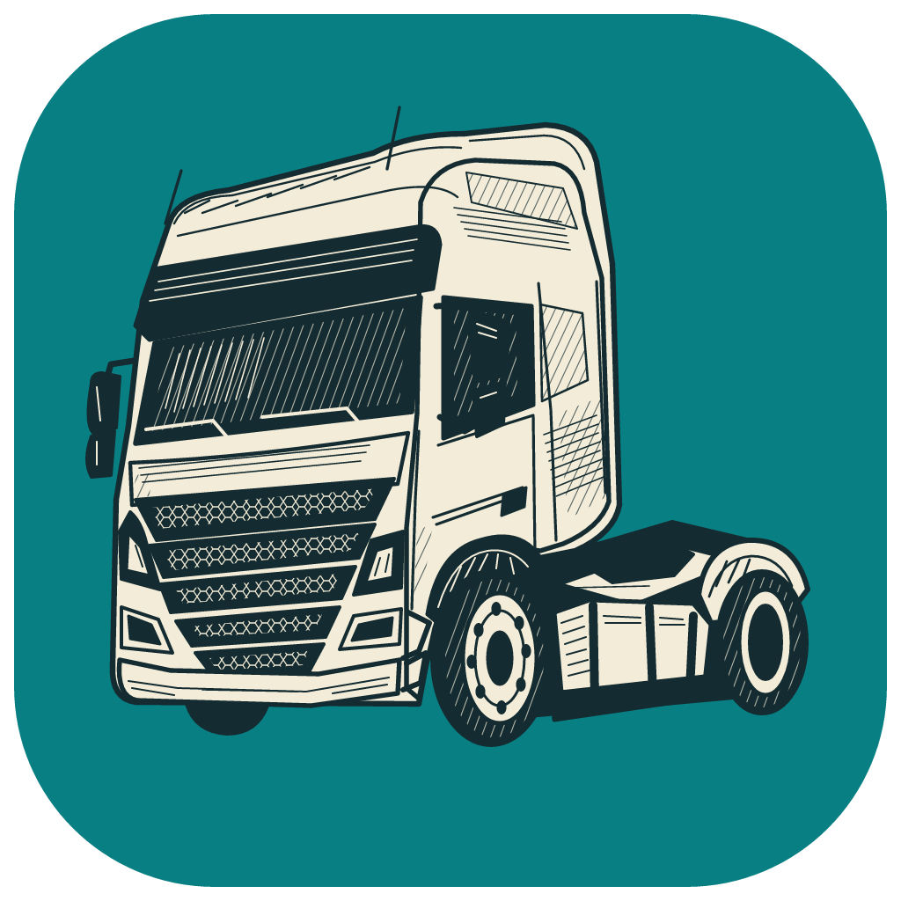
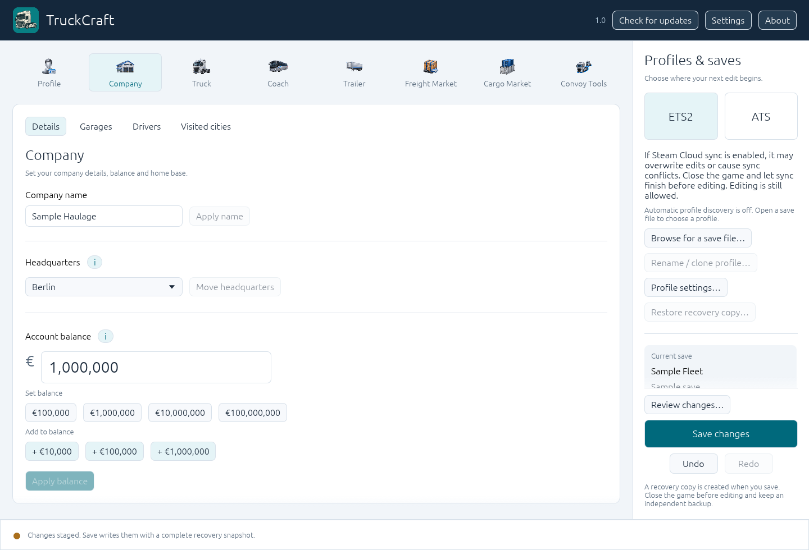

<p align="center">
  
</p>

<h1 align="center">TruckCraft</h1>

<p align="center">
  <strong>A modern save editor for Euro Truck Simulator 2 (ETS2) and American Truck Simulator (ATS).</strong><br>
  Tune your profile, manage your fleet, and edit jobs with a review step before saving.
</p>

<p align="center">
  <a href="#downloads"></a>
  <a href="#downloads"></a>
  <a href="#downloads"></a>
  <a href="#downloads"></a>
  <a href="#downloads"></a>
  <a href="https://github.com/chrissts/TruckCraft/actions/workflows/package-check.yml"></a>
</p>

<p align="center">
  <a href="https://buymeacoffee.com/truckcraft"></a>
</p>

<p align="center">
  <a href="#features">Features</a> ·
  <a href="#downloads">Downloads</a> ·
  <a href="#start-using-truckcraft">Get started</a> ·
  <a href="#build-from-source">Build from source</a>
</p>

<p align="center">
  
  <br>
  <sub>The Company tab brings your headquarters, balance, garages, and drivers together.</sub>
</p>

<table>
  <tr>
    <td width="33%" valign="top">
      <h3>Run your company</h3>
      Adjust your balance, garages, drivers, and profile progress.
    </td>
    <td width="33%" valign="top">
      <h3>Manage your fleet</h3>
      Edit fuel, wear, paint, and plates for saved trucks and trailers.
    </td>
    <td width="33%" valign="top">
      <h3>Review every edit</h3>
      Inspect staged changes, undo or redo an edit, and save with a recovery copy.
    </td>
  </tr>
</table>

## Downloads

Download TruckCraft from the [latest GitHub release](https://github.com/chrissts/TruckCraft/releases/latest).

| Platform | Asset | How to use it |
| --- | --- | --- |
| Windows x64 | `TruckCraft.exe` | Run the executable. |
| Fedora and Fedora-based distributions (x86-64) | `TruckCraft.rpm` | Install with `sudo dnf install ./TruckCraft.rpm`. |
| Ubuntu, Debian, and their derivatives (x86-64) | `TruckCraft.deb` | Install with `sudo apt install ./TruckCraft.deb`. |
| Arch Linux and CachyOS (x86-64) | `TruckCraft.pkg.tar.zst` | Install with `sudo pacman -U ./TruckCraft.pkg.tar.zst`. |
| Linux with Flatpak (x86-64, experimental) | `TruckCraft.flatpak` | Install with `flatpak install --user ./TruckCraft.flatpak`. |

**Opening TruckCraft on Windows.** I don’t have a Windows code-signing certificate, so `TruckCraft.exe` is unsigned. Windows may show **Unknown publisher** or Microsoft Defender SmartScreen’s **Windows protected your PC** prompt. If you downloaded the executable from the official release linked above and choose to run it, select **More info → Run anyway** when SmartScreen offers that option. If Defender reports a specific threat or quarantines the file, leave it blocked. [How SmartScreen works](https://learn.microsoft.com/windows/apps/package-and-deploy/smartscreen-reputation)

**macOS** is available as a universal test build from GitHub Actions, with automated smoke tests on Apple Silicon and Intel runners. Hands-on testing on a Mac is still pending. [macOS test builds](https://github.com/chrissts/TruckCraft/actions/workflows/package-check.yml)

The Linux packages are checked on Fedora 45, Ubuntu 26.04, Arch Linux, and CachyOS. Other distributions need compatible system libraries.

- **Bazzite** is Fedora-based. Use `TruckCraft.rpm` inside a Fedora 45 Distrobox container. TruckCraft has yet to be tested on Bazzite itself. [Bazzite’s Distrobox guide](https://docs.bazzite.gg/Installing_and_Managing_Software/Distrobox/)
- **SteamOS (experimental).** In Desktop Mode, use the Flatpak download and run the install command in Konsole. The bundle passed automated Linux sandbox tests. Testing on SteamOS and Steam Deck hardware is still pending. [Valve’s SteamOS desktop FAQ](https://help.steampowered.com/en/faqs/view/671A-4453-E8D2-323C)

## Start using TruckCraft

Choose **Create new save…** to create a fresh local profile without an existing save. Select the installed ETS2 or ATS 1.62.x game folder and its local data folder, then enter a new profile name. In the simulator, select the new profile and choose **Load Game → Fresh starter**. Choose your headquarters city when prompted, finish setup, and save again. Close the game and open that new save in TruckCraft.

ATS needs an installed starter truck model. TruckCraft checks for the free Kenworth T680, Kenworth W900, and Peterbilt 579 truck packs. Coach and Road Trip are optional for a fresh start.

1. **Close the game and back up your profile.** If Steam Cloud or OneDrive sync is enabled, let it finish before opening TruckCraft.
2. **Check the game, profile and save in the sidebar.** TruckCraft remembers a save for each game. To choose another, select it and click **Load selected save**, or browse directly to the slot’s `game.sii`.
3. **Edit, then apply.** For example, open **Company**, enter a balance and click **Apply balance**. Undo and Redo now cover that edit. If any fields still need applying, apply them or choose **Revert unapplied inputs** to enable saving.
4. **Choose Save changes**, then load the edited save in the game. TruckCraft takes a recovery snapshot before replacing files. If a file changed outside the editor, reload it first.

On Windows, launch `truckcraft.exe` from the application folder. For a source checkout or a native Linux or macOS package, see [Build from source](#build-from-source).

## Features

| Tab | What you can edit |
| --- | --- |
| Profile | XP, level, truck skills, ADR, portrait, company logo and saved colours |
| Company | Name, headquarters, exact integer balance, garages, hired drivers and visited cities |
| Truck and Trailer | Fleet and active job vehicles, fuel, wear, repairs, paint, saved addons and number plates |
| Coach · ETS2 | Coach XP, skills, stations, fleet, passengers, timetable and existing offers |
| Car · ATS | The active Road Trip car’s fuel, wear, repairs and number plates |
| Freight Market | Saved cargo and trailer combinations, destinations, urgency, expiry, distance and ferry costs |
| Cargo Market | Company and city offer seeds |
| Convoy Tools | Saved vehicle positions and GPS routes |

For **Coach** or **Car**, start a journey with the corresponding DLC in the game, save it, then reload in TruckCraft. The tab shows which DLC, vehicle or journey data is missing.

<details>
<summary>Vehicle, market and profile controls</summary>


**Number plates:** enter the plate text normally and choose its colour with the
picker. **Layout and badges…** provides controls for font scale, position,
alignment, raised/lowered text, separate text sections and images. No game markup
is required. Load game data in the plate editor to choose installed regions,
badge images and regional plate backgrounds. The preview uses a generic font
and approximates text placement. Germany also has a simplified preview before
game data is loaded. Changing the region preserves saved formatting tags.

**Saved paint colours:** click a swatch to open its colour picker. Sharing codes
are kept in **Import or share colours…**, separate from normal colour editing.

**Vehicle details:** choose **Component condition…** to edit individual wear
percentages, including each wheel and saved permanent wear. Zero means undamaged;
vehicle mileage is retained. **Paint colours…** edits the existing paint design
with colour pickers and lets you copy/import its colours for another vehicle.
Import fills the pickers; choose **Apply paint colours** to stage the edit.
**Parts…** lists saved accessories and offers saved addon alternatives for the
same model and slot. Structural part replacement needs a compatible game-data
catalog and is unavailable here. Shared accessories are protected from changes
that would silently affect another vehicle.

**Profile artwork:** when a local build has the game artwork installed, open
**Portrait and company logo…** on Profile, select an image and choose
**Apply portrait and logo**.

In **Settings → Game data**, **Load from game folder…** reads the selected
game's XP thresholds and number-plate badges. This affects level calculations
and presets. Your saved XP and pending edits are preserved. **Restore built-in
game data** returns to the verified 1.62 thresholds and clears the imported
badge choices.

Freight combinations currently come from offers already present in the loaded
save. TruckCraft keeps cargo, truck, trailer definition and variant together.
Choose a future absolute game-minute expiry; distance and ferry values are entered
manually. Positioned special-transport trailers cannot be cloned.

Click the **i** next to a market heading for help, or hover over an action for
its description. Cargo Market actions target either the selected depot or every
depot in its city. The game uses the saved seed values to generate the actual
offers.

TruckCraft can edit an existing Road Trip car. Road Trip offer creation is unavailable. Convoy position transfers require matching attached-trailer counts and compatible maps, DLC and mods.

</details>

## Find your saves

If the remembered save cannot load, TruckCraft tries discovered saves from newest to oldest, skipping backup profiles. If none load, choose a save file or a profile folder. Use **Add folder…** for another Steam library, a redirected folder or a custom `-homedir`.

<details>
<summary>Default folders on Windows, Linux, macOS and Steam Proton</summary>

Look for `profiles` or `steam_profiles` inside the game home. Replace `<game>` with `Euro Truck Simulator 2` or `American Truck Simulator`.

| Platform | Game home |
| --- | --- |
| Windows | The configured Documents folder, `%USERPROFILE%\Documents\<game>` or your OneDrive Documents folder |
| Linux | `$XDG_DATA_HOME/<game>` or `~/.local/share/<game>` |
| macOS | `~/Library/Application Support/<game>` |

TruckCraft also checks the default Steam installations, installation paths found in game logs and Steam userdata. Use app ID **227300** for ETS2 or **270880** for ATS.

- **Steam Cloud** — look under `Steam/userdata/<SteamID>/<app ID>/remote`. A Cloud path can exist even when sync is disabled. If sync is enabled, check the next sync for conflicts.
- **Proton** — look under `steamapps/compatdata/<app ID>/pfx/drive_c/users/steamuser/Documents/<game>` inside the Steam library. Common library roots are `~/.steam/steam` and `~/.var/app/com.valvesoftware.Steam/.local/share/Steam`.
- **Individual saves** — open `<profile>/save/<slot>/game.sii`. Enable **Include game backup profiles** to discover versioned backup folders.

</details>

## Profile tools and recovery

- **Recover from backup…** works from the opening screen or a failed-load message. Select the damaged slot and a snapshot, then name the new profile. TruckCraft copies the recovered journey into that profile.
- **Restore recovery copy…** opens snapshots for the loaded save. With pending edits cleared, select a snapshot and choose **Stage restoration**. Review it, then save to restore. TruckCraft first snapshots the current files.
- **Rename / clone profile…** operates directly on the profile folder after pending edits are resolved. A clone can include every save or only the autosave. A rename keeps the original under `.truckcraft-profile-backups`. Both require an unused destination name.
- **Profile settings…** exports selected controls and configuration files to a JSON bundle. Import a bundle for the same game and choose **Stage selected settings**. Save writes the staged settings and save edits together.

<details>
<summary>Settings files, languages and activity log</summary>

Profile settings include `config.cfg`, `config_local.cfg`, `controls.sii` and `gearbox_*.sii`. Restoring a snapshot removes settings that the edited transaction created. Older snapshots cover only the three save/profile files.

In **Settings → Language**, choose English, Deutsch, Français or Español. Missing translations and unsupported settings fall back to English. To contribute a translation, follow the [language guide](AGENTS.md#add-a-language).

**Settings → Log viewer…** opens the latest page of `TruckCraft.log`, with newest entries at the bottom. Logging is enabled by default and retains up to 2 MB. Uncheck **Write TruckCraft.log** to stop recording. Windows stores the log and `settings.json` in `%LOCALAPPDATA%\TruckCraft`.

</details>

## Build from source

The Windows x64 build uses Rust 1.100.0 and the GNU toolchain. Linux contributors can find native prerequisites for Ubuntu and Fedora in the [packaging guide](release/README.md), which also covers the universal macOS build.

```sh
cargo test --locked --workspace
cargo run --locked --release -p truckcraft
```

For a separately installed Windows GNU toolchain, use the wrapper to remap local paths in the binary.

```powershell
./build-rust.ps1 -ToolchainDirectory 'C:\path\to\rust-toolchain'
```

TruckCraft builds directly from a fresh checkout and can read regional plate artwork from a local game installation. Local builds can also use a complete set of separately supplied game artwork. [Artwork and provenance](crates/desktop/assets/ARTWORK.md)

To enable local checks, [install pre-commit](https://pre-commit.com/#install) and
run `pre-commit install` from the repository root. The hooks check staged files
for syntax, whitespace, merge markers, and private keys. Rust changes also run
`cargo fmt --check` using the installed Rust toolchain with `rustfmt`.
Use a Conventional Commits-style pull request title such as
`docs: add a support badge to the README`.

TruckCraft asks before enabling automatic update checks. **Check for updates at launch** is ticked by default and takes effect when you select **Continue**. When enabled, TruckCraft contacts GitHub in the background at launch and shows a dialog if a newer version is available. Change your choice in Settings or select **Check for updates** beside Settings to check manually. On Windows, download a verified update and choose **Install and restart** once pending save edits are resolved. On Linux, use your package manager after [setting up the repository](#linux-updates), or open the release and download the matching package. The dialog also links to macOS test builds and to manual downloads for Windows releases without verified update metadata.

## Linux updates

The [TruckCraft package feeds](https://chrissts.github.io/TruckCraft/) provide
signed packages for Ubuntu 26.04 x86-64 and compatible derivatives, Fedora 45,
Arch Linux and CachyOS. After adding the appropriate feed, install with
`sudo apt-get install truckcraft` on Ubuntu or `sudo dnf install truckcraft`
on Fedora. GitHub Actions refreshes the feeds when a stable release is published,
so your package manager can install later versions as part of its normal updates.
The [standalone packages](https://github.com/chrissts/TruckCraft/releases/latest)
are also available.

For APT, DNF or pacman, use the [TruckCraft signing key](https://chrissts.github.io/TruckCraft/truckcraft.asc).
Its OpenPGP fingerprint is `42392E03F1D2049A05E563261E577B6CDF11D3A3`.

<details>
<summary>Ubuntu 26.04 and compatible derivatives (APT)</summary>

```sh
curl -fsSLO https://chrissts.github.io/TruckCraft/truckcraft.asc
gpg --show-keys --fingerprint truckcraft.asc
# Compare the fingerprint above before installing the key.
sudo install -D -m 0644 truckcraft.asc /etc/apt/keyrings/truckcraft.asc
echo 'deb [arch=amd64 signed-by=/etc/apt/keyrings/truckcraft.asc] https://chrissts.github.io/TruckCraft/debian stable main' | sudo tee /etc/apt/sources.list.d/truckcraft.list
sudo apt-get update
sudo apt-get install truckcraft
```

</details>

<details>
<summary>Fedora 45 and compatible derivatives (DNF)</summary>

```sh
curl -fsSLO https://chrissts.github.io/TruckCraft/truckcraft.repo
sudo install -m 0644 truckcraft.repo /etc/yum.repos.d/truckcraft.repo
sudo dnf install truckcraft
```

Check the displayed fingerprint when DNF asks to import the signing key.

</details>

<details>
<summary>Arch Linux and CachyOS (pacman)</summary>

```sh
curl -fsSLO https://chrissts.github.io/TruckCraft/truckcraft.asc
gpg --show-keys --fingerprint truckcraft.asc
# Compare the fingerprint above before trusting the key.
sudo pacman-key --add truckcraft.asc
sudo pacman-key --lsign-key 42392E03F1D2049A05E563261E577B6CDF11D3A3
```

Add this section to `/etc/pacman.conf`, then run `sudo pacman -Syu truckcraft`.

```ini
[truckcraft]
SigLevel = Required
Server = https://chrissts.github.io/TruckCraft/arch/
```

</details>

<details>
<summary>Flatpak and SteamOS (experimental)</summary>

In Desktop Mode on SteamOS, open Konsole.

```sh
flatpak install --user https://chrissts.github.io/TruckCraft/TruckCraft.flatpakref
flatpak update --user io.github.chrissts.TruckCraft
```

If Flatpak reports that a standalone bundle is already installed, uninstall that
copy first without the `--delete-data` option, then install the repository build.

</details>

## Compatibility and verification

TruckCraft 1.0.3 targets **ETS2 1.62.x**, **ATS 1.62.x** and **save format 105**. About shows the loaded save’s actual format. Game updates, DLC, maps and mods can affect compatibility. Advanced vehicle parts, game-definition catalogs and some translations are incomplete.

The [desktop test workflow](.github/workflows/desktop-tests.yml) runs the workspace suite on Windows and Ubuntu for pull requests or a manual run. Pull requests that only change Markdown files run pre-commit and skip the workspace suite. In-game loading and a standalone run on a clean Windows installation remain release checks. See the [contributor checks](AGENTS.md#release-validation).

## Support and attribution

<a href="https://buymeacoffee.com/truckcraft"> Buy me a coffee</a>

[Report an issue](https://github.com/chrissts/TruckCraft/issues) with the game
version and reproduction steps. Remove personal information from logs and
screenshots; do not attach private profiles or whole saves.

TruckCraft is a **Rust remodel** of
[LIPtoH/TS-SE-Tool](https://github.com/LIPtoH/TS-SE-Tool).
The application is licensed under Apache-2.0.
See [LICENSE](LICENSE) and [NOTICE](NOTICE).
The Rust codec adapts [scs_tools](https://github.com/Wilps93/scs_tools), with its
MIT and additional upstream notices retained.

TruckCraft is an independent community project. The games, logos and bundled
game art belong to SCS Software and are outside the application license.
[Artwork sources and provenance](crates/desktop/assets/ARTWORK.md) are retained.
